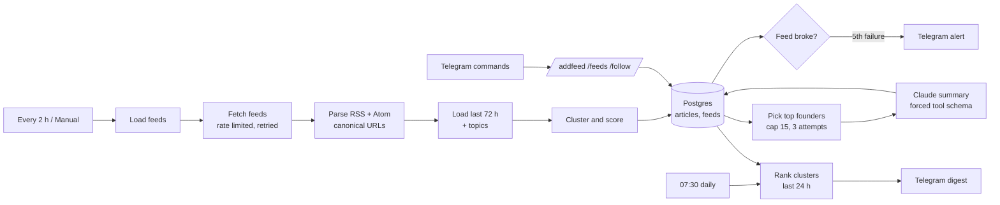

# AI News Intelligence Digest for n8n

> Follow dozens of RSS and Atom feeds, see each story **once** even when five sites cover it, rank it against the topics you care about, and get a short daily Telegram digest with two-sentence AI summaries. LLM use is capped and bounded by design.


## Table of contents

1. [What it does](#what-it-does)
2. [Architecture](#architecture)
3. [How the pipeline works](#how-the-pipeline-works)
4. [Setup](#setup)
5. [Telegram commands](#telegram-commands)
6. [Configuration](#configuration)
7. [Database](#database)
8. [Security](#security)
9. [Testing](#testing)
10. [Troubleshooting](#troubleshooting)
11. [Limitations](#limitations)
12. [Roadmap](#roadmap)

## What it does

| Stage | Behavior |
|---|---|
| **Fetch** | Every 2 hours, all enabled feeds are fetched (3 at a time, 1 s apart, 2 tries each). One broken feed never stops the others. |
| **Parse** | RSS 2.0 and Atom are parsed in code: CDATA, HTML, entities, relative links, guid-only items, bad dates. |
| **Dedupe** | URLs are canonicalized (tracking parameters and fragments removed, query sorted). A canonical URL is stored once. |
| **Cluster** | Titles are compared as word sets. The same story from different sources shares one `cluster_key`, matched across the last 72 hours and across runs. |
| **Score** | Each article is scored against your topics (keywords and weights). Title hits count 3x. |
| **Summarize** | Only the first article of each relevant cluster is summarized by a small Claude model: at most 15 per run, 3 attempts per article. |
| **Digest** | Daily at 07:30: top 12 stories of the last 24 hours, grouped by topic, with "N sources" lines. Long digests are split across messages. |
| **Health** | A feed that fails 5 runs in a row triggers one Telegram alert. A recovered feed resets silently. |
| **Manage** | `/addfeed`, `/feeds` and `/follow` let you change feeds and topics from Telegram. |

## Architecture



Four flows live in one workflow: ingest, daily digest, Telegram commands, and an Error Trigger flow.

## How the pipeline works

### Same story, different sources

Titles are lower-cased, stripped of accents, punctuation and common words, then turned into a word set. Two articles are the same story when they share at least **3 words** and their **Jaccard similarity is 0.6 or higher**.

> "OpenAI releases new GPT model for developers" and "New GPT model released by OpenAI for developers" share 4 of 6 distinct words (0.67) and are grouped.

The first article becomes the cluster founder. Later matches only add a source. This is a cheap lexical method; it does not understand synonyms (see [Limitations](#limitations)).

### Scoring

```
topic score = topic weight x min(6, 3 x title hits + summary hits)
relevance   = best topic score + 0.25 x sum of the other topic scores
```

Keywords match whole words (`ai` does not match "maintain") and are treated literally (`c++` works). The digest and the LLM stage only consider relevance of **3 or more**, so one passing summary mention of a keyword with weight 1 is not enough.

### Digest ranking

```
score = relevance + AI importance (1-5) + 2 x ln(number of distinct sources)
```

A story covered by three outlets gets a boost over a single-source story of the same relevance.

### Cost control

- Only cluster founders above the relevance threshold are summarized.
- At most **15 summaries per run**, retried at most **3 times** per article, only within 48 hours of fetching.
- The model reads the feed's own title and excerpt, not the full article.
- A small model (`claude-haiku-5-5` by default) is used. Change `MODEL` in *Build Summary Request*.

## Setup

### Requirements

- n8n 1.x
- PostgreSQL 13+
- An Anthropic API key (optional: without it, remove the summary branch and the digest still works from titles)
- A Telegram bot and your chat ID

### Steps

1. **Create the tables.** Run [`sql/schema.sql`](sql/schema.sql). It seeds 4 example feeds and 3 topics. Safe to run twice.
2. **Import** `workflows/news_intelligence_digest.json`.
3. **Credentials**

   | Credential | Type | Notes |
   |---|---|---|
   | Postgres account | Postgres | |
   | Telegram account | Telegram API | Bot token |
   | Anthropic API key | Header Auth | Name `x-api-key` |

4. **Replace placeholders**

   | Placeholder | Where |
   |---|---|
   | `REPLACE_WITH_DIGEST_CHAT_ID` | *Send Digest*, *Send Feed Alert*, *Send Error Alert* |
   | `REPLACE_WITH_ALLOWED_CHAT_ID` | Code node *Parse Command* (chat IDs allowed to manage feeds and topics) |
   | `REPLACE_ID` | Credential slots in all Postgres, Telegram and HTTP nodes |

5. **Set the Error Workflow** in Workflow Settings to this workflow.
6. **First run:** execute *Manual Fetch*, wait for it to finish, then execute *Manual Digest*. Activate the workflow when it looks right.

The first fetch only keeps items from the last 72 hours, so adding a feed with a long archive does not flood your database or your LLM budget.

## Telegram commands

Only chat IDs listed in *Parse Command* can use them. Anyone else gets a reply with their own chat ID and nothing else happens.

| Command | Effect |
|---|---|
| `/addfeed <url> [name]` | Add a feed. Only public `http(s)` URLs are accepted. |
| `/feeds` | List feeds with health: ✅ ok, ⚠️ 3+ failures, ⏸ disabled |
| `/follow Topic: kw1, kw2` | Create or replace a topic. Keywords are lower-cased, de-duplicated, max 20. |

Example: `/follow Indonesia tech: gojek, tokopedia, ojk, startup`

## Configuration

| Setting | Where | Default |
|---|---|---|
| Fetch schedule | *Every 2 Hours* | `0 */2 * * *` |
| Digest schedule | *Daily Digest Schedule* | `30 7 * * *` |
| Minimum relevance | *Pick For Summary* and *Digest Query* parameters | 3 |
| Summaries per run | *Pick For Summary* parameters | 15 |
| Digest size | *Digest Query* parameters | 12 |
| Title similarity | `SIM` and `MIN_SHARED` in *Cluster & Score* | 0.6 and 3 |
| Max article age | `MAX_AGE_HOURS` in *Cluster & Score* | 72 |
| Feed alert after | *Store Articles* parameters | 5 failures |
| Model | `MODEL` in *Build Summary Request* | `claude-haiku-5-5` |

## Database

| Table | Purpose |
|---|---|
| `feeds` | Feed URL, enabled flag, failure counter, last success and last error |
| `topics` | Topic name, keyword array, weight 1-5 |
| `articles` | Canonical URL (unique), title, cluster key, relevance, AI summary, attempts |

Useful queries:

```sql
-- Biggest stories of the week
SELECT cluster_key, COUNT(DISTINCT feed_id) AS sources, MAX(relevance) AS relevance
FROM articles WHERE fetched_at > now() - interval '7 days'
GROUP BY cluster_key ORDER BY sources DESC, relevance DESC LIMIT 20;

-- Retention: keep 30 days
DELETE FROM articles WHERE fetched_at < now() - interval '30 days';
```

## Security

- **Feed content is untrusted.** The model has no tools beyond a small output schema, is told to ignore instructions in the text, and its output is length-limited, validated and HTML-escaped before it reaches Telegram.
- **No SSRF through `/addfeed`.** Localhost, private IPv4 ranges, link-local and cloud metadata addresses, IPv6 literals, decimal/hex IP tricks, `.local` and `.internal` hosts and URLs with credentials are refused. The database also enforces `http(s)` only.
- **Feed URLs are fetched by your n8n server.** Only add feeds you trust. Cloud-hosted n8n and firewalls add extra protection; DNS rebinding is not handled by the command filter.
- **Commands fail closed.** An unknown chat ID, or the shipped placeholder, authorizes nobody.
- **SQL is parameterized.** Titles with quotes or SQL text are stored as data.
- **Links in Telegram** are `http(s)` only by construction (canonicalization drops other schemes) and attribute-escaped.
- **Terms of use.** Check each publisher's terms before storing or republishing its content. The workflow keeps only titles and short excerpts and links back to the source.

## Testing

- **Code nodes: 100 checks** with mocked n8n inputs: RSS and Atom parsing (CDATA, entities, relative and guid-only links, bad dates, `javascript:` links, 150-item feeds, oversized responses), canonical URLs, clustering (same story, other story, older runs, short titles), scoring (word boundaries, regex characters, caps), summary request and parsing, digest formatting and splitting, all Telegram commands including 18 blocked URL forms, and workflow structure.
- **SQL: 47 checks** on a real PostgreSQL engine (PGlite): constraints, idempotent inserts, feed-health state machine (exactly one alert on the 5th failure), the 72-hour lookback, the summary-attempt cap, digest ranking and the `/follow` upsert.

Not verified: a live n8n instance, live feeds, the Anthropic API and Telegram. Example feed URLs in the schema were not fetched from this environment; confirm them before relying on them.

## Troubleshooting

| Problem | Fix |
|---|---|
| Feed shows ⚠️ and "not an RSS or Atom feed" | The URL returns HTML (a landing page). Find the real feed URL in the page source (`<link rel="alternate">`). |
| Feed fails with HTTP 403 | Some sites block automated clients. Try another feed or contact the publisher. |
| Digest is empty | No article reached relevance 3. Add topics with `/follow` or lower the threshold in *Pick For Summary* and *Digest Query*. |
| Summaries missing | Check the Anthropic credential, model name and credit. Each article is tried 3 times, then left without a summary (the digest still shows it). |
| Same story appears twice | Titles differ too much for the lexical match. Lower `SIM` slightly (for example 0.5). |
| Different stories merged | Raise `SIM` or `MIN_SHARED`. |
| Telegram rejects a message | Messages are split under 4096 characters. A very long topic list can still hit the limit; reduce the digest size. |

## Limitations

- Clustering is lexical, not semantic. Translations and heavy rewording are not matched.
- Summaries use the feed excerpt only. Some feeds publish just a title.
- No full-text fetching and no paywall handling.
- Digest windows are exact (last 24 hours). Running *Manual Digest* repeatedly resends the same stories.
- One language set of stop words (English). Non-English titles still work but are matched less precisely.

## Roadmap

- Embeddings-based clustering (pgvector) for semantic duplicates
- Per-topic digests and per-user subscriptions
- Full-text extraction with a readability step
- Weekly trend report from the `articles` table
- Email and Slack outputs

## License

MIT. Add a `LICENSE` file to your repository.
